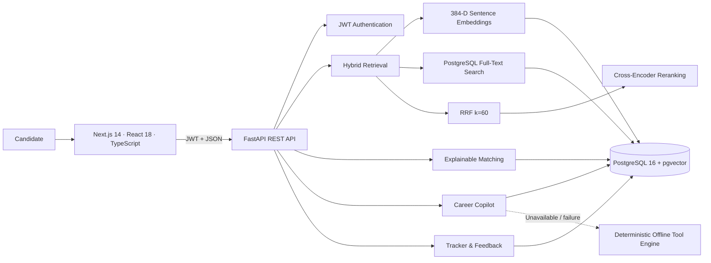

# MatchIQ

### AI-powered opportunity discovery, explainable matching, and career intelligence

[](https://match-iq-ochre.vercel.app/)
[](https://matchiq-backend-9b64.onrender.com/)
[](https://matchiq-backend-9b64.onrender.com/health)
[](https://github.com/rishika638/MatchIQ)

**MatchIQ turns a resume and career preferences into evidence-backed opportunity recommendations.** It combines dense vector retrieval, PostgreSQL keyword search, Reciprocal Rank Fusion, optional cross-encoder reranking, transparent candidate compatibility, persistent application tracking, and a tool-enabled AI career copilot.

<div align="center">

| Live product | API health | GitHub |
|---|---|---|
| [Open MatchIQ](https://match-iq-ochre.vercel.app/) | [Backend health](https://matchiq-backend-9b64.onrender.com/health) | [Source repository](https://github.com/rishika638/MatchIQ) |

</div>

---

## Why MatchIQ

Most job search experiences rely on isolated keyword filters or opaque recommendation scores. MatchIQ presents retrieval and matching as measurable, explainable systems.

| Capability | What it does |
|---|---|
| **Hybrid discovery** | Fuses 384-dimensional semantic embeddings with PostgreSQL full-text keyword matching |
| **Reciprocal Rank Fusion** | Combines independent rankings with `k = 60` |
| **Cross-encoder reranking** | Applies a query-document relevance model after hybrid retrieval |
| **Explainable matching** | Separates semantic, skill, experience, role, and preference components |
| **AI career copilot** | Executes real search, profile, save, compare, preference, and skill-gap tools |
| **Persistent tracker** | Stores lifecycle status, notes, feedback, conversations, tool calls, and search history |
| **Ground-truth evaluation** | Measures retrieval quality with Precision, Recall, MRR, NDCG, and latency |
| **Production deployment** | Runs Next.js on Vercel and FastAPI/PostgreSQL on Render |

---

## Product Modules

| Module | Production behavior |
|---|---|
| **Landing** | Product introduction and direct search entry |
| **Authentication** | JWT login and registration with tenant creation |
| **Dashboard** | Live database metrics, skill insights, search activity, and feedback summary |
| **Discover** | Keyword, semantic, hybrid RRF, reranked, filtered, and paginated retrieval |
| **Opportunity Details** | Full role data plus component-level candidate compatibility |
| **Profile** | Skills, experience, education, preferences, and PDF/TXT resume extraction |
| **AI Copilot** | Conversational tool execution with database-backed memory and offline fallback |
| **Saved Tracker** | Saved, applied, interviewing, offered, and archived lifecycle stages |
| **Comparison** | Side-by-side analysis of 2–4 opportunities |
| **Evaluation** | Persisted benchmark runs across all four retrieval methods |
| **Settings** | CSV/JSON ingestion, batch validation, duplicate handling, and embedding re-indexing |

---

## Architecture



### Hybrid Retrieval Pipeline

1. Normalize and tokenize the natural-language query.
2. Generate a 384-dimensional `all-MiniLM-L6-v2` embedding.
3. Retrieve semantically similar opportunities from pgvector.
4. Retrieve keyword matches across title, company, description, location, and skills.
5. Fuse semantic and keyword rankings using:

\[
RRF(d)=\sum_{m}\frac{1}{60+\operatorname{rank}_{m}(d)}
\]

6. Apply location, work mode, role type, salary, experience, and skills filters.
7. Optionally rerank candidates with `cross-encoder/ms-marco-MiniLM-L-6-v2`.
8. Return paginated results with retrieval metadata and explainable compatibility.

### Explainable Matching

The live compatibility engine is explicitly weighted:

| Component | Weight |
|---|---:|
| Semantic similarity | 30% |
| Skills overlap | 30% |
| Experience compatibility | 15% |
| Role relevance | 15% |
| Preference compatibility | 10% |

Required skills receive 75% of the skill component and nice-to-have skills receive 25%. Experience and preference penalties are calculated independently of the hard eligibility violations.

### AI Career Copilot

The copilot can execute:

- `search_opportunities`
- `get_opportunity_details`
- `save_opportunity`
- `compare_opportunities`
- `get_candidate_profile`
- `update_candidate_preferences`
- `analyze_skill_gaps`

Tool calls and results are persisted, while the deterministic engine provides a database-backed fallback when Gemini is unavailable or returns an error.

---

## Verified Engineering Results

> The numbers below come from executed local QA and fresh-database migration tests. They are system-quality evidence, not production traffic or live business metrics.

### Database and Ingestion QA

| Verification | Result |
|---|---|
| Original seed opportunities | **100** |
| Synthetic records added during local QA | **113** |
| Local database opportunity total after QA | **213** |
| Opportunity embeddings verified | **213** |
| Embeddings with 384 dimensions | **213** |
| Fresh PostgreSQL tables | **20** |
| Fresh migration benchmark queries | **10** |
| Fresh migration relevance judgments | **542** |
| Fresh migration seed opportunities | **100** |
| Fresh migration demo users | **0** |
| Smoke test | **10/10 backend flows passed** |

The ingestion QA covered 1-record JSON, 10-record CSV, 100-record JSON, duplicate IDs, invalid records, partial failures, BOM-prefixed JSON, 11 MB upload rejection, re-indexing, embedding persistence, and searchability.

### Matching Evidence

A profile skill change for one synthetic opportunity demonstrated measurable explainability:

| Metric | Before | After |
|---|---:|---:|
| Overall compatibility | 89.4% | 76.0% |
| Semantic similarity | 72.2% | 52.5% |
| Skills overlap | 100.0% | 75.0% |
| Experience compatibility | 100.0% | 100.0% |
| Role relevance | 85.0% | 85.0% |
| Preference compatibility | 100.0% | 100.0% |

Removing `Python` also correctly changed the missing-skills result and reduced the overall score by **13.4 percentage points**.

### Retrieval Benchmark QA

The 10-query benchmark suite used 542 stored relevance judgments. These are measured local QA results against an active corpus—not projected or simulated improvements.

| Retrieval method | MRR | NDCG@5 | Precision@3 | Recall@5 | Avg latency |
|---|---:|---:|---:|---:|---:|
| Keyword | 0.1167 | 0.1763 | 0.6667 | 0.0494 | 8.85 ms |
| Dense semantic | **0.9500** | **0.8022** | **1.0000** | **0.1009** | 66.54 ms |
| Hybrid RRF | 0.2600 | 0.1782 | 0.7000 | 0.0464 | 44.03 ms |
| Hybrid reranked | 0.5667 | 0.6321 | 0.8333 | 0.0745 | 1993.74 ms |

The reranker benchmark was CPU-bound in the test environment. The dense semantic method led on MRR and NDCG for this benchmark snapshot, while reranking improved the hybrid Precision@3 result over plain hybrid RRF.

### Smoke and Build QA

- `docker compose exec backend python scripts/test_smoke.py` — **passed**
- Backend health, login, profile, search, details, save, Copilot, feedback, dashboard, and evaluation checks — **passed**
- Frontend TypeScript `tsc --noEmit` — **passed**
- Next.js `npm run build` — **passed**
- Clean backend Docker build — **passed**
- Backend image size after CPU-only dependency hardening — **451.47 MB**
- PyTorch packaged as CPU-only `2.6.0+cpu`; no CUDA/NVIDIA dependency stack
- Frontend lint — passed with four React Hook dependency warnings
- No backend pytest test modules were present; the repository smoke script is the tested backend suite

---

## Security and Reliability

Verified controls include:

- PBKDF2-HMAC-SHA256 salted password hashing
- Stateless JWT bearer authentication
- Invalid JWT and malformed JSON rejection
- User-isolated saved opportunities
- SQL-injection string handling through parameterized ORM queries
- 10 MB dataset and resume upload limits
- 10,000-record dataset limit
- Explicit CORS origin allowlists with wildcard origin rejection
- Login, registration, ingestion, agent, resume, and evaluation rate limits
- HTTP 429 response verification for login bursts
- Cross-encoder and Gemini fallback behavior
- Database-backed health check
- Production secret and CORS startup validation
- pgvector migration and fresh PostgreSQL verification

Production initialization is separated from local demo seeding. Demo credentials are never created by the normal production seed command.

---

## Tech Stack

### Frontend


### Backend


### Data and AI


### Infrastructure


---

## Deployment

| Surface | Platform | Live URL |
|---|---|---|
| Frontend | Vercel | [match-iq-ochre.vercel.app](https://match-iq-ochre.vercel.app/) |
| Backend | Render | [matchiq-backend-9b64.onrender.com](https://matchiq-backend-9b64.onrender.com/) |
| Swagger / API docs | Render | [Open API docs](https://matchiq-backend-9b64.onrender.com/api/v1/docs) |
| Health | Render | [Check backend health](https://matchiq-backend-9b64.onrender.com/health) |

The Swagger route is a documented API surface. If a production deployment disables FastAPI docs, the route may return HTTP 404; `/health` remains the deployment health endpoint.

For deployment configuration, use the `.env.example`, backend Dockerfile, frontend API client, and Docker Compose setup.

---

## Local Setup

### Docker Compose

```bash
git clone https://github.com/rishika638/MatchIQ.git
cd MatchIQ
cp .env.example .env
docker compose up --build
```

- Frontend: `http://localhost:3000`
- Backend: `http://localhost:8000`
- Swagger, when enabled: `http://localhost:8000/api/v1/docs`
- Health: `http://localhost:8000/health`

Docker startup can use demo seeding explicitly:

```bash
cd backend
python scripts/init_and_seed.py --demo
```

Production-style initialization, migrations, and benchmark loading:

```bash
cd backend
alembic upgrade head
python scripts/init_and_seed.py
```

### Frontend

```bash
cd frontend
npm ci
npm run typecheck
npm run lint
npm run build
npm run dev
```

Set `NEXT_PUBLIC_API_URL` to the deployed backend API base, ending in `/api/v1`.

### Backend

```bash
cd backend
python -m venv .venv

# macOS/Linux
source .venv/bin/activate

# Windows PowerShell
.venv\Scripts\Activate.ps1

pip install -r requirements.txt
uvicorn app.main:app --host 0.0.0.0 --port 10000
```

---

## Repository Structure

```text
MatchIQ/
├── backend/
│   ├── app/
│   │   ├── api/v1/          # REST route modules
│   │   ├── core/            # Settings, JWT, database, rate limiting
│   │   ├── models/          # SQLAlchemy entities
│   │   ├── schemas/         # Pydantic request and response schemas
│   │   └── services/        # Search, matching, ingestion, agent, evaluation
│   ├── migrations/          # Alembic schema migrations
│   ├── scripts/             # Migration, initialization, seed, smoke scripts
│   ├── Dockerfile
│   └── requirements.txt
├── frontend/
│   └── src/
│       ├── app/             # Landing and 11 application experiences
│       ├── components/      # Shared navigation and UI components
│       └── lib/             # API client
├── data/
│   ├── seed/                # Original 100-opportunity dataset
│   └── evaluation/          # Ground-truth benchmark queries
├── docs/
│   ├── architecture.md
│   ├── api.md
│   ├── evaluation.md
│   └── deployment guide
├── docker-compose.yml
└── .env.example
```

---

## Screenshots

MatchIQ's live product is the visual source of truth. No verified screenshot assets are currently stored in this repository, so this README does not claim or embed unexecuted UI captures.

Explore the deployed interface:

- [Landing and Search](https://match-iq-ochre.vercel.app/)
- [Opportunity Discovery](https://match-iq-ochre.vercel.app/discover)
- [Dashboard](https://match-iq-ochre.vercel.app/dashboard)
- [AI Career Copilot](https://match-iq-ochre.vercel.app/agent)
- [Benchmark Evaluation](https://match-iq-ochre.vercel.app/evaluation)

---

<div align="center">

**Built to show the engineering behind every recommendation.**

[Live Demo](https://match-iq-ochre.vercel.app/) · [Backend](https://matchiq-backend-9b64.onrender.com/) · [GitHub](https://github.com/rishika638/MatchIQ)

</div>
