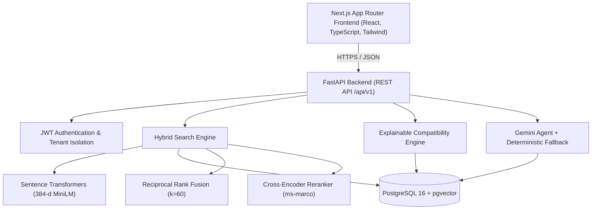

# MatchIQ — Architecture & System Design

## 1. Overview & High-Level Architecture

MatchIQ is an AI-powered SaaS platform engineered to deliver semantic opportunity discovery, explainable candidate compatibility, and autonomous career copilot workflows.

---

## 2. Multi-Stage Hybrid Search Pipeline

MatchIQ implements an 8-stage retrieval pipeline:

1. **Query Preprocessing**: Whitespace normalization, token extraction, and query sanitation.
2. **Dense Vector Embedding**: Converts natural language queries into 384-dimensional unit-normalized embeddings via Sentence Transformers (`all-MiniLM-L6-v2`).
3. **pgvector Cosine Retrieval**: Evaluates nearest neighbors using cosine distance (`<=>` operator in PostgreSQL pgvector).
4. **PostgreSQL Full-Text Search**: Keyword matching across title, company, description, and required skills.
5. **Reciprocal Rank Fusion (RRF)**:
   $$RRF\_Score(d) = \sum_{m \in \{\text{vector}, \text{fts}\}} \frac{1}{k + rank_m(d)}$$
   where $k = 60$.
6. **Hard Eligibility Constraint Filtering**: Separates non-negotiable candidate constraints (experience tenure floors, location restrictions, work modes, opportunity types, salary minimums).
7. **Optional Cross-Encoder Reranking**: Fine-grained query-document cross-attention scoring using `cross-encoder/ms-marco-MiniLM-L-6-v2`.
8. **Explainable Match Scoring & Pagination**: Generates itemized skill overlap and candidate fit breakdowns.

---

## 3. Explainable Matching Engine

The compatibility engine evaluates 5 weighted components:

| Component | Weight | Description |
| :--- | :--- | :--- |
| **Semantic Similarity** | 30% | Cosine similarity between candidate embedding and opportunity embedding |
| **Skills Overlap** | 30% | Weighted ratio of required (75%) and nice-to-have (25%) technical skills |
| **Experience Compatibility** | 15% | Candidate tenure years relative to opportunity min/max requirements |
| **Role Relevance** | 15% | Title and target role alignment |
| **Preference Compatibility** | 10% | Location, work mode, and compensation threshold satisfaction |

Hard constraint violations (such as experience deficits or mismatched opportunity types) are evaluated separately to prevent misleading scores.

---

## 4. Autonomous AI Career Copilot

The AI Copilot operates using explicit function calling:
- `search_opportunities(query, filters)`
- `get_opportunity_details(opportunity_id)`
- `save_opportunity(opportunity_id)`
- `compare_opportunities(opportunity_ids)`
- `get_candidate_profile()`
- `update_candidate_preferences(preferences)`
- `analyze_skill_gaps(opportunity_id)`

### Dual-Engine Design:
1. **Gemini SDK Mode**: When `GEMINI_API_KEY` is present, the configured Gemini model reasons and executes tool calls against the live database.
2. **Deterministic Engine Mode**: When API credentials are absent or during rate limits, the deterministic fallback engine parses intent and executes backend tools directly.

---

## 5. Multi-Tenant Architecture & Data Isolation

All database tables (`candidate_profiles`, `saved_opportunities`, `search_history`, `conversations`, `recommendation_feedbacks`, `ingestion_jobs`) enforce user-level and organization-level ownership boundaries.
